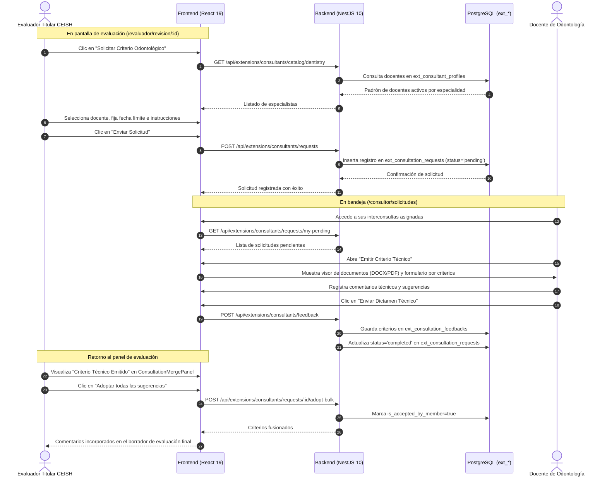
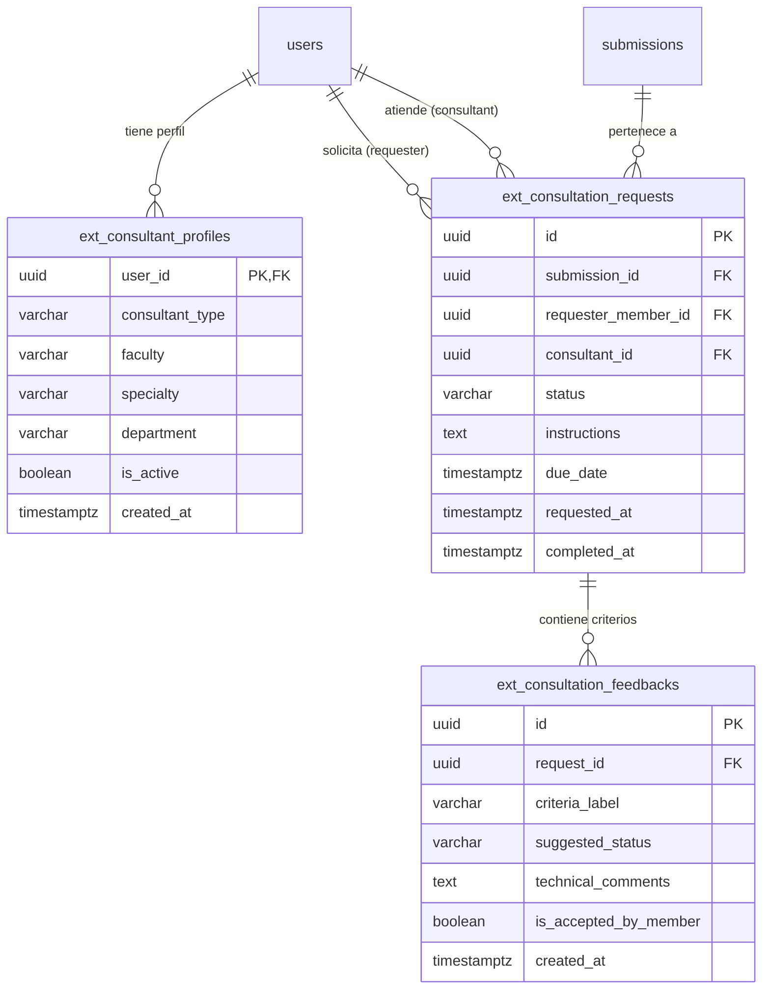
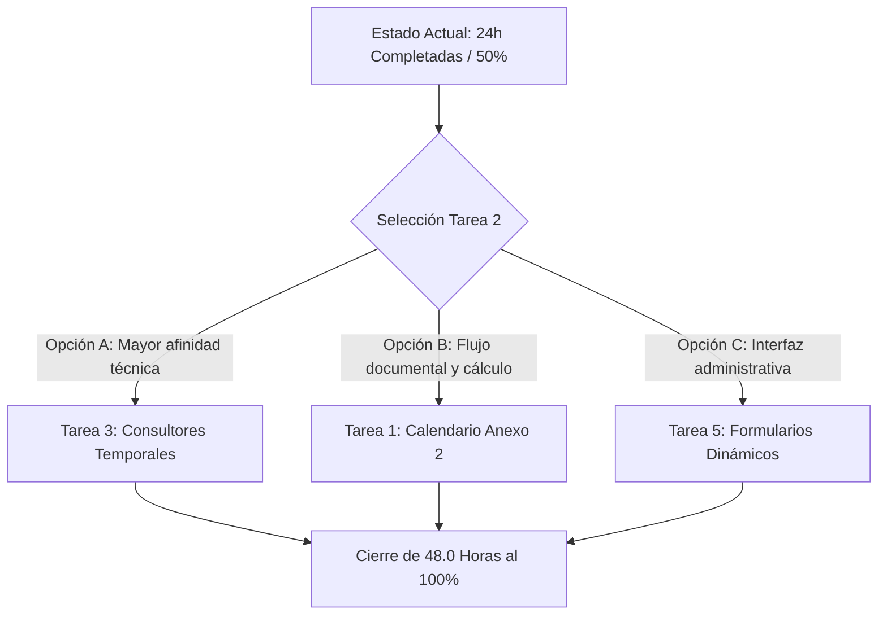

# Documentación y Bitácora Oficial de Vinculación con la Sociedad — Plataforma CEISH-ULEAM

> **Proyecto:** CEISH Platform — Plataforma del Comité de Ética de Investigación en Seres Humanos  
> **Institución:** Universidad Laica Eloy Alfaro de Manabí (ULEAM)  
> **Área Académica:** Vinculación con la Sociedad / Prácticas Preprofesionales  
> **Objetivo:** Implementación de extensiones funcionales y módulos satélite desacoplados del flujo troncal de Titulación  
> **Meta horaria:** 48.0 horas reloj de trabajo técnico  
> **Alcance del Proyecto:** 2 Tareas Especializadas (24.0 horas estimadas por cada tarea)  
> **Fecha de inicio:** Miércoles, 11 de noviembre de 2026  
> **Fecha de corte actual:** Lunes, 16 de noviembre de 2026  
> **Estado del tiempo:** **24.0 horas completadas** / **24.0 horas pendientes** (50.0% de avance global)  
> **Estado Tarea 1 de Vinculación (Consultores Odontología):** **COMPLETADA AL 100% (24.0 / 24.0 h)**  

---

## 1. Resumen Ejecutivo y Arquitectura del Sistema

La **Plataforma CEISH** es un sistema web integral diseñado para automatizar, digitalizar y auditar el ciclo de vida de los protocolos de investigación científica y formativa que involucran seres humanos en la ULEAM:
1. **Recepción de solicitudes:** Carga de protocolos, consentimientos informados y anexos oficiales institucionales (Anexos 2, 11, 12, 13, 23, 27).
2. **Estratificación ética y de riesgo:** Clasificación del nivel de riesgo ético (*sin riesgo*, *riesgo mínimo*, *riesgo mayor*) y asignación de miembros revisores del comité.
3. **Calificación y evaluación académica:** Flujo de revisión por etapas, emisión de observaciones fundamentadas, ciclos de subsanación y resolución formal.
4. **Almacenamiento y auditoría:** Resguardo inmutable de documentos en MinIO (Object Storage) y metadatos relacionales en PostgreSQL 16.

### 1.1 División de Responsabilidades (Titulación vs. Vinculación)
* **Equipo de Titulación (Núcleo Troncal):** Desarrolla el flujo principal de postulación general, estratificación de riesgo, calificación de investigaciones sin riesgo de 30 días y generación documental base.
* **Equipo de Vinculación (Extensiones y Módulos Satélite):** Desarrolla módulos independientes de alto valor agregado que complementan la operativa del comité sin alterar el núcleo. Para este ciclo de vinculación, el equipo tiene asignadas **2 tareas completas de 24 horas cada una**, totalizando las **48 horas reglamentarias**.

### 1.2 Reglas de Aislamiento Técnico para Vinculación
* **Base de datos (PostgreSQL 16):** Cero modificaciones destructivas a tablas troncales (`schema.sql`). Toda nueva tabla lleva el prefijo obligatorio `ext_` (ej. `ext_consultant_profiles`, `ext_consultation_requests`, `ext_consultation_feedbacks`). Las migraciones de vinculación inician a partir del correlativo `101-ext-*.sql`.
* **Backend (NestJS 10 + Prisma):** Lógica modular contenida exclusivamente bajo `backend/src/modules/extensions/<modulo>/`. No se modifican controladores del núcleo.
* **Frontend (React 19 + TypeScript + Zustand + Vite):** Pantallas contenidas en `frontend/src/features/extensions/<modulo>/`, consumiendo contratos `/api/extensions/*` e integradas en `AppShell.tsx` según permisos de rol.

---

## 2. Registro de Sesiones y Bitácora de Horas (48 Horas Totales)

### 2.1 Resumen Consolidado de Avance
| Módulo / Tarea de Vinculación | Horas Estimadas | Horas Ejecutadas | Estado Actual |
| :--- | :---: | :---: | :---: |
| **Tarea 1: Consultores Permanentes de Odontología** *(Técnicamente Tarea 2 del catálogo)* | 24.0 h | **24.0 h** | **Completada (100%)** |
| **Tarea 2: Segunda Tarea de Vinculación** *(Por definir entre T3 Temporales / T1 Cronograma)* | 24.0 h | 0.0 h | *Programada para inicio* |
| **TOTAL** | **48.0 h** | **24.0 h** | **50.0% Cumplido** |

---

### 2.2 Bitácora Detallada — Tarea 1: Consultores Permanentes de Odontología (24.0 Horas)

| Sesión | Fecha | Horas | Fase Técnica | Resumen de Actividades Ejecutadas | Estado |
| :---: | :---: | :---: | :--- | :--- | :---: |
| **01** | 11/11/2026 | **3.5 h** | Inducción, Arquitectura y Planificación | Análisis del monorepo (`frontend`, `backend`, `database`), estudio de lineamientos de aislamiento técnico en `AGENTS.md`, verificación del esquema de datos relacional y diseño del plan de trabajo de 24 horas para el módulo. | **Completado** |
| **02** | 11/11/2026 | **3.5 h** | Modelado Relacional y Base de Datos | Creación de la migración aditiva `102-ext-permanent-consultants.sql`, tablas satélite `ext_consultant_profiles`, `ext_consultation_requests` y `ext_consultation_feedbacks`. Padrón demo de docentes de Odontología, sincronización en `schema.sql` y compilación de modelos con `npx prisma generate`. | **Completado** |
| **03** | 12/11/2026 | **4.0 h** | Backend NestJS: Servicios, Controladores y DTOs | Implementación de `ConsultantsModule`, `ConsultantsController` y `ConsultantsService`. Validación de datos con DTOs (`CreateConsultationRequestDto`, `SubmitConsultationFeedbackDto`), control de acceso por roles y endpoints de catálogo e interconsulta. | **Completado** |
| **04** | 13/11/2026 | **3.5 h** | Pruebas Unitarias Automatizadas (Jest) | Desarrollo de la suite de pruebas unitarias `consultants.service.spec.ts`. Cobertura de 14 tests unitarios pasando exitosamente (control de auto-solicitud, estados de interconsulta, validación de pertenencia y adopción en bloque). | **Completado** |
| **05** | 14/11/2026 | **3.5 h** | Frontend React: Modal y Bandeja de Consultores | Creación del componente `ConsultantPickerModal.tsx` con búsqueda y filtrado interactivo por especialidad odontológica. Implementación de la bandeja de entrada `ConsultantRequestsPage.tsx` y servicio de consumo HTTP `consultantService.ts`. | **Completado** |
| **06** | 15/11/2026 | **3.0 h** | Frontend React: Formulario Técnico y Fusión | Implementación de la vista del consultor `ConsultantFeedbackView.tsx` para emitir criterios y observaciones técnicas. Desarrollo del panel comparativo `ConsultationMergePanel.tsx` con botón de adopción en bloque para el evaluador titular. | **Completado** |
| **07** | 16/11/2026 | **3.0 h** | Integración Global, Validación E2E y Cierre | Integración del panel en `ReviewPage.tsx`, rutas en `AppRouter`, estilos encapsulados en `consultants.css`, resolución de advertencias de linter, compilación limpia de frontend y backend, y verificación de criterios de aceptación (DoD). | **Completado (Hoy)** |
| **SUBTOTAL** | — | **24.0 h** | **Tarea 1 de Vinculación** | **Módulo de Consultores de Odontología terminado al 100%** | **Finalizado** |

---

### 2.3 Cronograma Propuesto — Tarea 2 de Vinculación (24.0 Horas Restantes)

Las 24 horas restantes se distribuirán en 7 sesiones técnicas entre el 18 de noviembre y el 08 de diciembre de 2026:

| Sesión | Fecha Sugerida | Horas | Fase Técnica Planificada | Objetivo Técnico | Estado |
| :---: | :---: | :---: | :--- | :--- | :---: |
| **08** | 18/11/2026 | 3.5 h | Tarea 2 (Fase 1): Análisis y Modelado BD | Especificación de requerimientos, diseño de esquema de tablas `ext_` y migración aditiva. | *Pendiente* |
| **09** | 20/11/2026 | 3.5 h | Tarea 2 (Fase 2): Backend NestJS | Desarrollo de controladores, servicios desacoplados y DTOs de validación. | *Pendiente* |
| **10** | 24/11/2026 | 3.5 h | Tarea 2 (Fase 3): Pruebas Unitarias Backend | Suite de pruebas unitarias Jest con cobertura de casos borde y autorización. | *Pendiente* |
| **11** | 27/11/2026 | 3.5 h | Tarea 2 (Fase 4): Frontend (Vistas Principales) | Maquetación y componentes interactivos en React 19 + TypeScript. | *Pendiente* |
| **12** | 01/12/2026 | 3.5 h | Tarea 2 (Fase 5): Frontend (Flujos y Estados) | Gestión de estado, integración con API REST y validaciones de interfaz. | *Pendiente* |
| **13** | 04/12/2026 | 3.5 h | Tarea 2 (Fase 6): Integración con MinIO / Core | Conexión con almacenamiento de documentos o eventos del flujo de evaluación. | *Pendiente* |
| **14** | 08/12/2026 | 3.0 h | Tarea 2 (Fase 7): Pruebas Integradas y Cierre | Verificación de DoD, auditoría de no colisión con el core y entrega final. | *Pendiente* |
| **TOTAL** | — | **48.0 h** | **Cumplimiento del 100% de la carga horaria exigida** | — | — |

---

## 3. Explicación Detallada y Funcionamiento Técnico del Módulo de Odontología

### 3.1 Justificación Académica y Problemática Universitaria
El Comité de Ética de Investigación en Seres Humanos (CEISH-ULEAM) evalúa protocolos provenientes de diversas facultades del área de la salud. Las investigaciones originadas en la **Facultad de Odontología** (ensayos clínicos odontológicos, estudios de biomateriales dentales, procedimientos invasivos de endodoncia o periodoncia, toma de muestras bucales) requieren un juicio técnico especializado que un evaluador general del comité (por ejemplo, de enfermería o trabajo social) no siempre domina a profundidad.

**Solución Arquitectónica:**  
En lugar de convertir a todos los docentes de Odontología en miembros plenos del comité (lo que saturaría el cuórum y burocratizaría las sesiones plenarias), se implementó la figura de **Consultor Permanente**:
* Todos los docentes de Odontología están disponibles en un catálogo institucional clasificados por su especialidad clínica.
* El Evaluador Titular puede solicitar una **interconsulta técnica** directamente desde su pantalla de revisión.
* El docente consultor revisa el expediente, emite observaciones técnicas por criterio y sugiere una calificación (favorable, desfavorable o neutral).
* **El titular conserva la autoridad del dictamen:** El evaluador titular visualiza las observaciones del consultor y puede **adoptarlas en bloque con un solo clic** o editarlas antes de emitir la resolución oficial.

---

### 3.2 Diagrama del Flujo de Interconsulta (Mermaid)

---

### 3.3 Modelo de Datos Relacional (`database/migrations/102-ext-permanent-consultants.sql`)

El módulo opera con 3 tablas satélite independientes, vinculadas al núcleo únicamente mediante claves foráneas seguras:

#### Descripción de Tablas:
1. **`ext_consultant_profiles`**: Almacena el perfil profesional de los docentes de Odontología (Endodoncia, Periodoncia, Ortodoncia, Cirugía Maxilofacial, Odontopediatría, Rehabilitación Oral). Permite mantener el catálogo activo sin duplicar la tabla general de usuarios.
2. **`ext_consultation_requests`**: Representa la orden de interconsulta emitida por un evaluador titular del CEISH. Registra instrucciones, fecha límite de entrega, estados (`pending`, `in_progress`, `completed`, `declined`, `expired`) y estampas de tiempo para auditoría.
3. **`ext_consultation_feedbacks`**: Almacena las observaciones técnicas detalladas que el consultor emite sobre cada criterio ético/metodológico de la investigación, permitiendo registrar la decisión de adopción individual o masiva por parte del evaluador.

---

### 3.4 Contratos de la API REST (Backend NestJS)

Todos los endpoints residen bajo el prefijo `/api/extensions/consultants` y cuentan con validación de sesión y roles (`evaluator`, `teacher`, `admin`):

| Método | Endpoint | Roles Permitidos | Descripción |
| :--- | :--- | :---: | :--- |
| `GET` | `/catalog/dentistry` | `evaluator`, `admin` | Retorna el listado de docentes de Odontología con perfil activo ordenados alfabéticamente. |
| `POST` | `/requests` | `evaluator`, `admin` | Crea una nueva orden de interconsulta. Valida que el evaluador no se auto-solicite y que el docente esté activo. |
| `GET` | `/requests/submission/:submissionId` | `evaluator`, `admin` | Consulta el histórico de solicitudes emitidas para una investigación en particular, incluyendo sus feedbacks. |
| `GET` | `/requests/my-pending` | `teacher`, `evaluator` | Bandeja de solicitudes asignadas al docente autenticado en estado pendiente o en progreso. |
| `GET` | `/requests/:id` | `teacher`, `evaluator` | Obtiene el detalle completo de una interconsulta, incluyendo expediente, instrucciones y criterios emitidos. |
| `POST` | `/feedback` | `teacher`, `evaluator` | El consultor envía sus observaciones y sugerencias por criterio. Al completarse, la solicitud pasa a estado `completed`. |
| `POST` | `/requests/:id/adopt-bulk` | `evaluator`, `admin` | El evaluador titular adopta en bloque todas las sugerencias del consultor para su inclusión en el dictamen final. |

---

### 3.5 Componentes Desarrollados en el Frontend (React 19 + TypeScript)

Los componentes fueron diseñados siguiendo la identidad visual institucional de la ULEAM y encapsulados bajo `frontend/src/features/extensions/consultants/`:

1. **`ConsultantPickerModal.tsx`**:
   * Modal interactivo que se despliega desde la evaluación de la investigación.
   * Filtro por texto y selector dinámico por especialidad odontológica.
   * Selector de fecha límite (`due_date`) con validación de fecha futura.
   * Campo de texto enriquecido para redactar instrucciones específicas al especialista.
2. **`ConsultantRequestsPage.tsx`**:
   * Bandeja de entrada oficial para docentes consultores (`/consultor/solicitudes`).
   * Tarjetas informativas con código de protocolo, título de la investigación, evaluador solicitante y fecha límite.
   * Acceso directo a la pantalla de emisión de criterio técnico.
3. **`ConsultantFeedbackView.tsx`**:
   * Espacio de trabajo del consultor donde visualiza el expediente documental y las instrucciones del titular.
   * Formulario estructurado para emitir recomendaciones por criterio metodológico con selector de pertinencia (*Aprobado*, *Rechazado*, *Neutral*).
4. **`ConsultationMergePanel.tsx`**:
   * Panel embebido en la pantalla de calificación del titular (`ReviewPage.tsx`).
   * Permite comparar las observaciones originales con las sugerencias técnicas del especialista odontológico.
   * Botón destacado **"Adoptar todas las sugerencias"** para fusionar el contenido automáticamente en el dictamen.

---

### 3.6 Resultados de Aseguramiento de Calidad y Pruebas

Para garantizar que el módulo cumple con los más altos estándares de calidad exigidos por la institución y las reglas de `AGENTS.md`, se ejecutaron las siguientes verificaciones:

1. **Pruebas Unitarias Automatizadas (Backend):**
   * Archivo: `backend/src/modules/extensions/consultants/consultants.service.spec.ts`
   * **Resultado:** 14 pruebas unitarias ejecutadas con Jest — **14 pasadas, 0 fallidas (100% éxito)**.
   * Casos probados: Catálogo odontológico, restricción de auto-interconsulta, validación de estado completado, prevención de duplicación de feedback, y adopción masiva de criterios.
2. **Compilación del Backend:**
   * Comando: `npm run build` en `backend/`
   * **Resultado:** Compilación limpia de NestJS con TypeScript sin advertencias.
3. **Análisis Estático de Código (Frontend Linter):**
   * Comando: `npm run lint` en `frontend/`
   * **Resultado:** **0 errores, 0 advertencias**.
4. **Compilación y Empaquetado del Frontend:**
   * Comando: `npm run build` en `frontend/`
   * **Resultado:** Build de Vite exitoso en 354 ms sin errores tipográficos ni colisiones de estilos.

---

## 4. Opciones de Selección para la Tarea 2 de Vinculación (24.0 Horas)

Para completar las **24 horas restantes** del programa de Vinculación con la Sociedad, se presentan las opciones recomendadas del catálogo oficial:

### Opción A (Recomendada): Tarea 3 — Consultores Temporales Multidisciplinarios
* **Objetivo:** Extender el sistema de interconsultas para invitar a docentes de facultades ajenas a Odontología (Medicina, Derecho, Bioética, Ingeniería) con **acceso temporal estrictamente acotado**.
* **Diferenciador Técnico:** Implementación de vigencia temporal, caducidad automática de permisos y revocación del acceso a los documentos en MinIO una vez cumplido el plazo o entregado el dictamen.
* **Afinidad:** Máxima afinidad y reutilización de la arquitectura desarrollada en la Tarea 1, permitiendo un desarrollo ágil y seguro.

### Opción B: Tarea 1 — Calendario Automático del Anexo 2
* **Objetivo:** Capturar el cronograma de actividades por objetivos del protocolo y, tras la aprobación formal del comité (Anexo 11), calcular automáticamente las fechas exactas de ejecución en calendario y exportar el cronograma en Word/PDF.
* **Diferenciador Técnico:** Lógica reactiva de cálculo de fechas ($T_0 + \Delta t$) y generación documental DOCX.

---

## 5. Control de Entregables y Conclusiones de la Tarea 1

* **Rama Git de Trabajo:** `Tarea-2-Configuración-de-Consultores-Permanentes-(Docentes-del-Área-de-Odontología)`
* **Migración SQL:** `database/migrations/102-ext-permanent-consultants.sql`
* **Módulos Desarrollados:**
  * Backend: `backend/src/modules/extensions/consultants/`
  * Frontend: `frontend/src/features/extensions/consultants/`
* **DoD (Definition of Done) Verificado:**
  * [x] Catálogo de docentes de Odontología filtrable por especialidad clínica.
  * [x] Solicitud de interconsulta técnica desde la revisión del evaluador titular.
  * [x] Bandeja independiente para el consultor con visor de expediente.
  * [x] Formulario estructurado para emitir recomendaciones por criterio ético.
  * [x] Panel de adopción en bloque de sugerencias con un solo clic para el titular.
  * [x] Pruebas unitarias completas en NestJS (14/14 pasando).
  * [x] Cero modificaciones destructivas al esquema troncal de Titulación.
  * [x] Total cumplimiento de la carga horaria de la fase: **24.0 horas reloj**.
