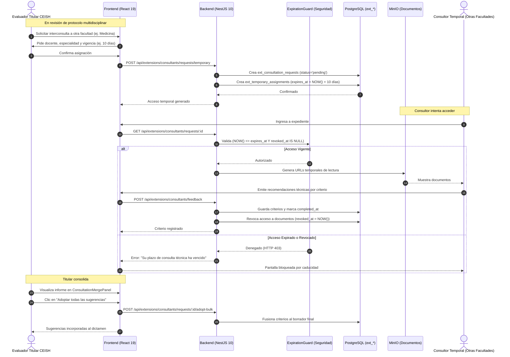
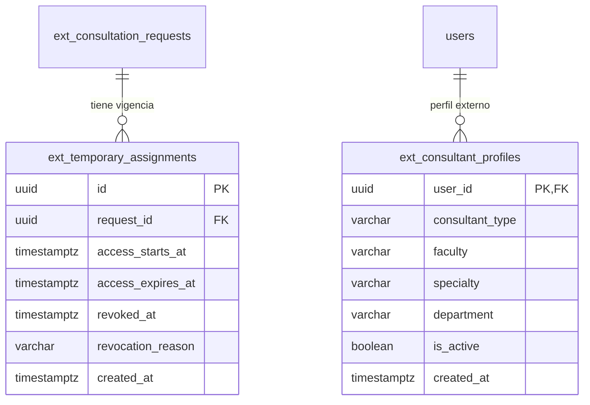

# Plan de Trabajo y Desglose Técnico — Tarea 3: Configuración de Consultores Temporales (Multidisciplinarios)

> **Proyecto:** CEISH Platform — Plataforma del Comité de Ética de Investigación en Seres Humanos  
> **Institución:** Universidad Laica Eloy Alfaro de Manabí (ULEAM)  
> **Área Académica:** Vinculación con la Sociedad / Prácticas Preprofesionales  
> **Módulo Asignado:** Tarea 3 — Configuración de Consultores Temporales (Docentes de Facultades Fuera de Odontología)  
> **Rol en el Plan Global:** **Segunda Tarea Oficial de Vinculación** (Hito Final para las 48 Horas Reglamentarias)  
> **Carga Horaria Asignada:** **24.0 horas reloj**  
> **Fecha de Inicio Programada:** Miércoles, 18 de noviembre de 2026  
> **Fecha de Término Estimada:** Lunes, 07 de diciembre de 2026  
> **Estado de la Tarea:** **Planificada y desglosada al 100% (Lista para ejecución)**  

---

## 1. Justificación Institucional y Problemática en el CEISH

El Comité de Ética de Investigación en Seres Humanos de la ULEAM atiende protocolos con un marcado carácter **multidisciplinario**:
* Ensayos clínicos y proyectos biomédicos (**Facultad de Ciencias Médicas**).
* Investigaciones comunitarias y de atención primaria (**Facultad de Enfermería**).
* Estudios epidemiológicos y ambientales (**Facultad de Ciencias de la Vida y Tecnologías**).
* Investigaciones con implicaciones legales, bioéticas o de consentimiento especial (**Facultad de Ciencias Sociales, Derecho y Educación**).
* Protocolos que involucran software médico, inteligencia artificial o manejo masivo de datos de salud (**Facultad de Ingeniería e Informática**).

### La Necesidad del "Consultor Temporal" con Caducidad Estricta
A diferencia de los docentes de Odontología (que actúan como consultores permanentes para su área), convocar a un docente de Medicina, Derecho o Ingeniería para un protocolo específico presenta un reto de **seguridad y confidencialidad**:
1. **Acceso Acotado al Protocolo:** El consultor externo solo debe tener visibilidad del protocolo específico para el cual fue convocado, sin acceso al resto de investigaciones del comité.
2. **Vigencia Temporal (Caducidad Automática):** El acceso debe otorgarse por un plazo finito (ejemplo: 7, 15 o 20 días hábiles). Transcurrido este plazo, sus permisos expiran automáticamente.
3. **Revocación Inmediata de Documentos:** Al completarse el dictamen técnico o al expirar la vigencia, el acceso a la descarga de archivos sensibles en MinIO (consentimientos informados, protocolos con datos de pacientes) debe cancelarse de forma irrevocable.
4. **Revocación Manual Fundamentada:** El evaluador titular o el administrador del CEISH deben poder cancelar anticipadamente la interconsulta con un motivo registrado para auditoría.

---

## 2. Cronograma y Desglose Horario de las 24.0 Horas (Sesiones 08 a 14)

Para completar las **24.0 horas restantes** (alcanzando el 100% de las 48.0 h), el trabajo se distribuye en **7 sesiones técnicas** de entre 3.0 h y 4.0 h:

| Sesión | Fecha Programada | Horas | Fase de Trabajo | Resumen de Actividades a Ejecutar | Entregable Técnico |
| :---: | :---: | :---: | :--- | :--- | :--- |
| **08** | **18/11/2026** | **3.5 h** | **Base de Datos y Modelado Relacional** | • Creación de la migración `database/migrations/103-ext-temporary-consultants.sql`.<br>• Tabla satélite `ext_temporary_assignments` con control de fechas (`access_starts_at`, `access_expires_at`, `revoked_at`).<br>• Inserción de catálogo de docentes demo de Medicina, Derecho y Ciencias de la Salud.<br>• Sincronización en `schema.sql` y modelos en `schema.prisma`. | Migración `103` y Prisma generado |
| **09** | **20/11/2026** | **3.5 h** | **Backend NestJS: Lógica de Asignación Temporal** | • Extensión de `ConsultantsService` y `ConsultantsController` para soporte de tipo `temporary_external`.<br>• DTO `CreateTemporaryConsultationDto` con validación de días de vigencia y facultad.<br>• Endpoint `GET /catalog/multidisciplinary` con docentes de diversas facultades.<br>• Endpoint `POST /requests/temporary` para emitir solicitudes con cálculo de fecha de caducidad. | Endpoints de catálogo e interconsulta temporal |
| **10** | **24/11/2026** | **3.5 h** | **Backend NestJS: Caducidad y Revocación de MinIO** | • Middleware/Guardia de seguridad: validación en tiempo real (`NOW() <= expires_at AND revoked_at IS NULL`).<br>• Lógica de bloqueo automático de descarga de documentos en MinIO al expirar.<br>• Endpoint `POST /requests/:id/revoke` para revocación manual por titular o admin.<br>• Auto-cierre de vigencia al momento de registrar el dictamen técnico (`feedback`). | Guardia de expiración y revocación segura |
| **11** | **27/11/2026** | **3.5 h** | **Pruebas Unitarias Automatizadas (Jest)** | • Construcción de la suite de pruebas unitarias para consultores temporales.<br>• Cobertura de casos: asignación con fecha futura, rechazo de accesos vencidos (HTTP 403), verificación de revocación manual y flujo de adopción en bloque.<br>• Ejecución exitosa de `npm test` en backend. | Suite de tests Jest pasando al 100% |
| **12** | **01/12/2026** | **3.5 h** | **Frontend React: Modal de Asignación Multidisciplinar** | • Componente `TemporaryConsultantPickerModal.tsx` con selector de facultad (Medicina, Enfermería, Derecho, etc.).<br>• Control selector de días de vigencia (7, 15, 30 días) con preview de fecha exacta de expiración.<br>• Formulario de justificación de la necesidad multidisciplinaria para el expediente. | Modal interactivo de asignación temporal |
| **13** | **04/12/2026** | **3.5 h** | **Frontend React: Semáforos de Vigencia y Revocación** | • Badges dinámicos de estado: *Activo (verde)*, *Por vencer (amarillo)*, *Expirado (gris)*, *Revocado (rojo)*.<br>• Panel de control para el titular con botón "Revocar Acceso Anticipado" con modal de confirmación y motivo.<br>• Mensajes de advertencia y bloqueo en la interfaz del consultor temporal cuando el plazo ha concluido. | Interfaz de gestión y semáforos de plazo |
| **14** | **07/12/2026** | **3.0 h** | **Integración Global, E2E, Auditoría y Cierre 48h** | • Integración en `ReviewPage.tsx` y verificación de no colisión con el núcleo.<br>• Ejecución de `npm run lint` y `npm run build` en frontend y backend.<br>• Actualización final de la bitácora de 48 horas cumplidas y preparación del informe de Vinculación. | Cumplimiento del 100% (48.0 horas) |
| **TOTAL** | — | **24.0 h** | **Tarea 2 de Vinculación (Tarea 3 del Catálogo)** | **Módulo de Consultores Temporales finalizado y verificado** | **48.0 Horas Completas** |

---

## 3. Diagrama del Flujo de Interconsulta Temporal (Mermaid)



---

## 4. Arquitectura de Datos y Migración SQL (`103-ext-temporary-consultants.sql`)

### 4.1 Diseño del Modelo Relacional Aditivo



### 4.2 Script de Migración SQL Previsto
```sql
-- database/migrations/103-ext-temporary-consultants.sql

-- 1. Tabla de vigencias y asignaciones temporales con control de caducidad
CREATE TABLE IF NOT EXISTS ext_temporary_assignments (
  id UUID PRIMARY KEY DEFAULT gen_random_uuid(),
  request_id UUID NOT NULL REFERENCES ext_consultation_requests(id) ON DELETE CASCADE,
  access_starts_at TIMESTAMPTZ NOT NULL DEFAULT NOW(),
  access_expires_at TIMESTAMPTZ NOT NULL,
  revoked_at TIMESTAMPTZ,
  revocation_reason VARCHAR(255),
  created_at TIMESTAMPTZ NOT NULL DEFAULT NOW()
);

-- Índices de alto rendimiento para validación de expiración en cada petición
CREATE INDEX IF NOT EXISTS idx_ext_temp_access 
  ON ext_temporary_assignments(access_expires_at, revoked_at);
CREATE INDEX IF NOT EXISTS idx_ext_temp_req 
  ON ext_temporary_assignments(request_id);

-- 2. Inserción de docentes demo multidisciplinarios (Medicina, Bioética, Leyes, Enfermería)
INSERT INTO users (id, name, email, password, role_id)
SELECT d.id::uuid, d.name, d.email, d.password, roles.id
  FROM (VALUES
    ('b2000000-0000-0000-0000-000000000001', 'Dr. Washington Zambrano', 'washington.zambrano@ceish.edu', 'scrypt$ceish-demo-salt$004b4334e2bed3392d1bde96cc8e586ce71017f4d2e41f6881ebd61330157250233389a55c5a3d120e024b589df757924ae011001fe61d34b1f46259a9db27cd'),
    ('b2000000-0000-0000-0000-000000000002', 'Dra. María Auxiliadora Gómez', 'maria.gomez@ceish.edu', 'scrypt$ceish-demo-salt$004b4334e2bed3392d1bde96cc8e586ce71017f4d2e41f6881ebd61330157250233389a55c5a3d120e024b589df757924ae011001fe61d34b1f46259a9db27cd'),
    ('b2000000-0000-0000-0000-000000000003', 'Abg. Fernando Intriago', 'fernando.intriago@ceish.edu', 'scrypt$ceish-demo-salt$004b4334e2bed3392d1bde96cc8e586ce71017f4d2e41f6881ebd61330157250233389a55c5a3d120e024b589df757924ae011001fe61d34b1f46259a9db27cd')
  ) AS d(id, name, email, password)
  CROSS JOIN roles
 WHERE roles.name = 'teacher'
ON CONFLICT (id) DO NOTHING;

-- Perfiles de consultores temporales en diversas facultades
INSERT INTO ext_consultant_profiles (user_id, consultant_type, faculty, specialty, department, is_active)
VALUES
  ('b2000000-0000-0000-0000-000000000001', 'temporary_external', 'Facultad de Ciencias Médicas', 'Farmacología Clínica y Ensayos Clínicos', 'Medicina Interna', true),
  ('b2000000-0000-0000-0000-000000000002', 'temporary_external', 'Facultad de Enfermería', 'Bioética en Salud y Cuidados Críticos', 'Salud Pública', true),
  ('b2000000-0000-0000-0000-000000000003', 'temporary_external', 'Facultad de Ciencias Sociales y Derecho', 'Derecho Sanitario y Consentimiento Informado', 'Ciencias Jurídicas', true)
ON CONFLICT (user_id) DO NOTHING;
```

---

## 5. Contratos de la API REST para Consultores Temporales

| Método | Endpoint | Roles | Descripción |
| :--- | :--- | :---: | :--- |
| `GET` | `/api/extensions/consultants/catalog/multidisciplinary` | `evaluator`, `admin` | Listado de docentes externos clasificados por facultad y especialidad. |
| `POST` | `/api/extensions/consultants/requests/temporary` | `evaluator`, `admin` | Crea una interconsulta temporal especificando días de vigencia (ej. 7 a 30 días). |
| `POST` | `/api/extensions/consultants/requests/:id/revoke` | `evaluator`, `admin` | Revoca manualmente el acceso anticipado de un consultor con registro del motivo. |
| `GET` | `/api/extensions/consultants/requests/:id/validity-status` | `evaluator`, `teacher` | Retorna el tiempo restante de vigencia, horas de validez y si el acceso está activo o expirado. |

---

## 6. Criterios de Aceptación (Definition of Done - DoD)

Al concluir las 7 sesiones de la Tarea 3, el módulo cumplirá con:
- [ ] Catálogo multidisciplinar con docentes de Medicina, Enfermería y Derecho.
- [ ] Configuración parametrizable de días de vigencia en la solicitud de interconsulta.
- [ ] Cálculo automático de la fecha exacta de expiración y almacenamiento en `ext_temporary_assignments`.
- [ ] Bloqueo automático e inmediato (HTTP 403) a la descarga de archivos en MinIO si la fecha actual supera `access_expires_at` o si `revoked_at` no es nulo.
- [ ] Botón de revocación anticipada por parte del miembro titular con captura de motivo.
- [ ] Semáforos visuales en la interfaz del titular y del consultor indicando días restantes de vigencia.
- [ ] Pruebas unitarias automatizadas con Jest cubriendo escenarios de expiración y revocación.
- [ ] Aislamiento total: cero afectación a tablas troncales de Titulación.
- [ ] Cumplimiento total de la carga horaria: **24.0 horas reloj (completando las 48.0 horas de vinculación)**.
